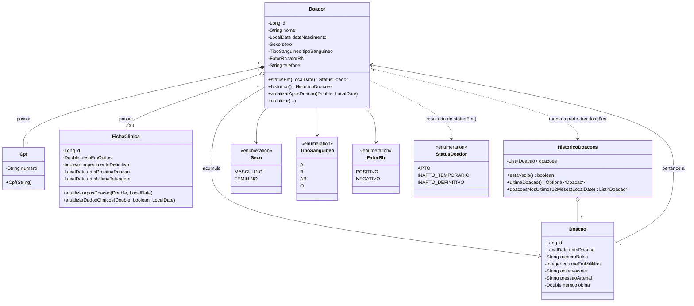
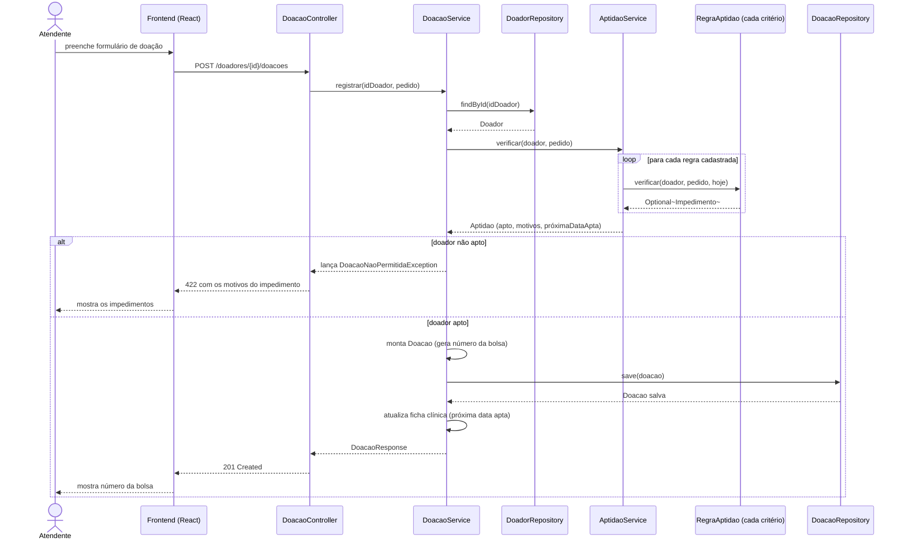

# HemoVida

Sistema web para gestão de doações de sangue, desenvolvido como projeto acadêmico da avaliação M1 (UMC).
Roda só localmente: não há deploy, Docker nem banco externo.

## Stack

- Backend: Java 21, Spring Boot, Maven, H2 em memória
- Frontend: React + Vite

## Arquitetura

Camadas do backend: `controller` recebe a requisição HTTP, `service` aplica as regras de negócio, `repository` fala com o banco. As regras de aptidão para doação (idade, peso, intervalo entre doações, limite anual, tatuagem recente, entre outras) são isoladas em classes próprias, uma por critério, em `service/regra`.

### Diagrama de classes

Modelo de domínio (`br.umc.hemovida.model`). O banco não aparece como classe porque é infraestrutura, acessada pelos repositórios, não parte do domínio.



`Cpf` é um value object (`record` imutável, `@Embeddable`), sem id ou ciclo de vida próprio: vive sempre dentro de um `Doador`. `Doador` e `FichaClinica` têm relação 1:1, com a ficha só existindo junto do doador. `Doador` e `Doacao` têm relação 1:N. `HistoricoDoacoes` não é entidade persistida: é montada sob demanda a partir da lista de doações de um doador.

### Diagrama de sequência

Fluxo de registro de uma doação (`POST /api/v1/doadores/{id}/doacoes`), o caminho que passa pelas regras de aptidão antes de gravar qualquer coisa.



`AptidaoService` não decide sozinho: percorre todas as implementações de `RegraAptidao` e junta os impedimentos encontrados. Nada é gravado em `DoacaoRepository` se a doadora ou doador não estiver apto. O mesmo `AptidaoService` é reaproveitado pelo endpoint `GET /doadores/{id}/aptidao`, que roda esse fluxo só até a consulta, sem gravar a doação.

## Pré-requisitos

- **Java 21** (`java -version` deve mostrar 21)
- **Node.js LTS** (`node -v`), que já inclui o `npm`
- Não é preciso instalar o Maven: o Maven Wrapper (`mvnw`) baixa a versão certa na primeira execução
- Acesso à internet na primeira execução, para baixar as dependências

## Configuração (uma vez)

O backend lê os segredos de `backend/.env`, que não vai para o repositório.

1. Copie o modelo:
   - Windows: `copy backend\.env.example backend\.env`
   - Linux/macOS: `cp backend/.env.example backend/.env`
2. Abra `backend/.env` e preencha os três valores:

| Variável | O que é |
|---|---|
| `JWT_SECRET` | Segredo que assina os tokens. Precisa ter **pelo menos 32 caracteres** |
| `ADMIN_PASSWORD` | Senha do usuário `admin` |
| `ATENDENTE_PASSWORD` | Senha do usuário `atendente` |

Para gerar um `JWT_SECRET` aleatório (funciona em qualquer sistema, usando o Node):

```
node -e "console.log(require('crypto').randomBytes(32).toString('hex'))"
```

As senhas são livres: use as que quiser. O `admin` pode tudo, inclusive excluir doadores; o `atendente` faz tudo, menos excluir.

## Como rodar

### Opção rápida

Na raiz do projeto, o script abre o backend e o frontend em dois terminais:

- Windows: dê dois cliques em `iniciar.bat` (ou rode `.\iniciar.bat` no terminal)
- Linux/macOS: `sh iniciar.sh`

### Opção manual

Em um terminal, o backend:

```
cd backend
./mvnw spring-boot:run
```

No Windows, use `.\mvnw.cmd spring-boot:run` (o `.\` é obrigatório no PowerShell e, em alguns computadores, também no `cmd`). Se der "permissão negada" no Linux/macOS, rode `chmod +x mvnw` ou use `sh mvnw spring-boot:run`.

Em outro terminal, o frontend:

```
cd frontend
npm install
npm run dev
```

O backend está pronto quando o log mostra `Started HemovidaApplication`.

## Endereços

| O quê | Endereço |
|---|---|
| Sistema (frontend) | http://localhost:5173 |
| API (backend) | http://localhost:8080/api/v1 |
| Swagger | http://localhost:8080/swagger-ui.html |

Se a porta 5173 estiver ocupada, o Vite usa a próxima livre e mostra o endereço certo no terminal.
O frontend acessa a API pelo proxy do Vite, então não há CORS para configurar.

Entre no sistema com o usuário `admin` ou `atendente` e a senha que você definiu no `.env`.

**Swagger:** faça o login em `POST /api/v1/auth/login`, copie o `token` da resposta, clique em **Authorize** e cole o token.

## Dados de demonstração

O banco é H2 em memória e **os dados são recarregados do zero a cada início do backend**: 15 doadores fictícios, com doações em datas relativas a hoje. Tudo o que for cadastrado, alterado ou excluído durante o uso se perde ao reiniciar.

## Testes

```
cd backend && ./mvnw verify
cd frontend && npm run build
```

## Problemas comuns

| Sintoma | Causa e solução |
|---|---|
| O backend não sobe e pede `JWT_SECRET`, `ADMIN_PASSWORD` ou `ATENDENTE_PASSWORD` | `backend/.env` não existe ou tem valor em branco. Siga a seção Configuração |
| `JWT_SECRET deve ter pelo menos 32 caracteres` | Gere um segredo maior com o comando acima |
| Porta 8080 em uso | Feche o outro programa que usa a porta 8080 e inicie o backend de novo |
| `Unsupported class file major version` ou erro de compilação | O Java em uso não é o 21. Confira `java -version` |
| Login diz "Usuário ou senha inválidos" | Use `admin` ou `atendente` e a senha do `.env`. Se mudou o `.env`, reinicie o backend |
