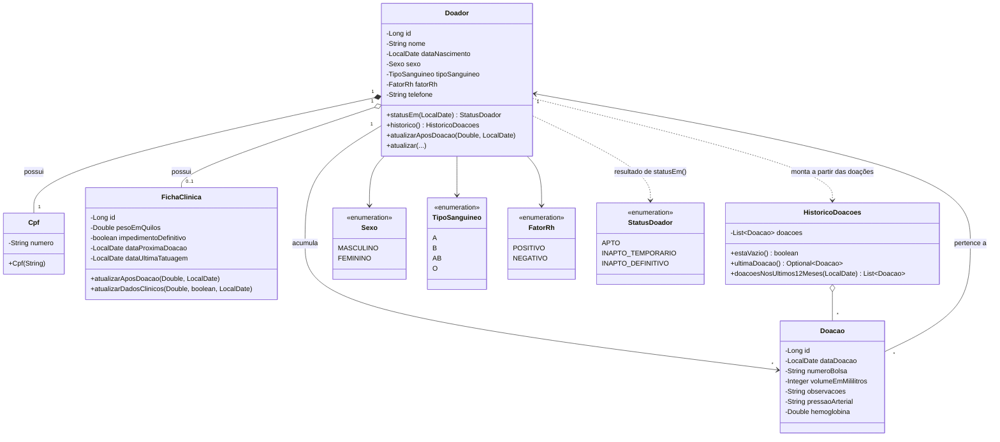

# Diagrama de classes

Modelo de domínio do HemoVida: `br.umc.hemovida.model`. O banco (H2) não aparece como classe porque é infraestrutura, acessada através dos repositórios (`DoadorRepository`, `DoacaoRepository`), não parte do domínio.

## Observações

- `Cpf` é um *value object* (`record` imutável, `@Embeddable`), não uma entidade própria: vive sempre dentro de um `Doador`, sem id ou ciclo de vida independente.
- `Doador` e `FichaClinica` têm relação 1:1: a ficha só existe junto com o doador (`cascade = ALL`, `orphanRemoval = true`).
- `Doador` e `Doacao` têm relação 1:N: um doador acumula várias doações ao longo do tempo.
- `HistoricoDoacoes` não é uma entidade persistida. É montada sob demanda a partir da lista de doações de um doador (`Doador.historico()`), para agrupar as regras de consulta ao histórico (última doação, doações nos últimos 12 meses) fora da entidade `Doador`.
