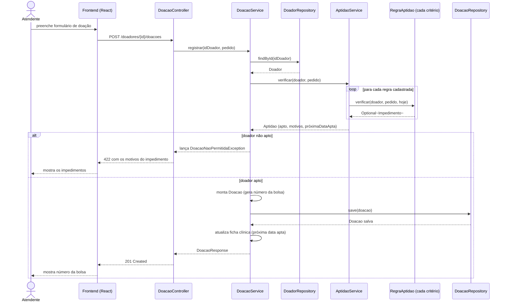

# Diagrama de sequência

Fluxo de registro de uma doação (`POST /api/v1/doadores/{id}/doacoes`), o caminho que passa pelas regras de aptidão antes de gravar qualquer coisa.

## Observações

- `AptidaoService` não decide sozinho: ele percorre todas as implementações de `RegraAptidao` (idade, peso, intervalo, limite anual, primeira doação, tatuagem, impedimento) e junta os impedimentos encontrados.
- Nada é gravado em `DoacaoRepository` se `aptidao.apto()` for falso. A verificação acontece antes da gravação, não depois.
- O mesmo `AptidaoService` é reaproveitado pelo endpoint `GET /doadores/{id}/aptidao`, que roda esse fluxo só até a consulta, sem a parte de gravar a doação.
